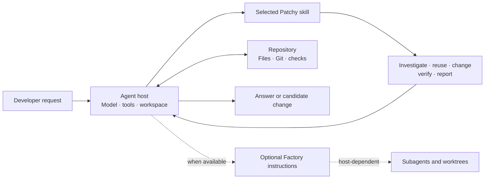
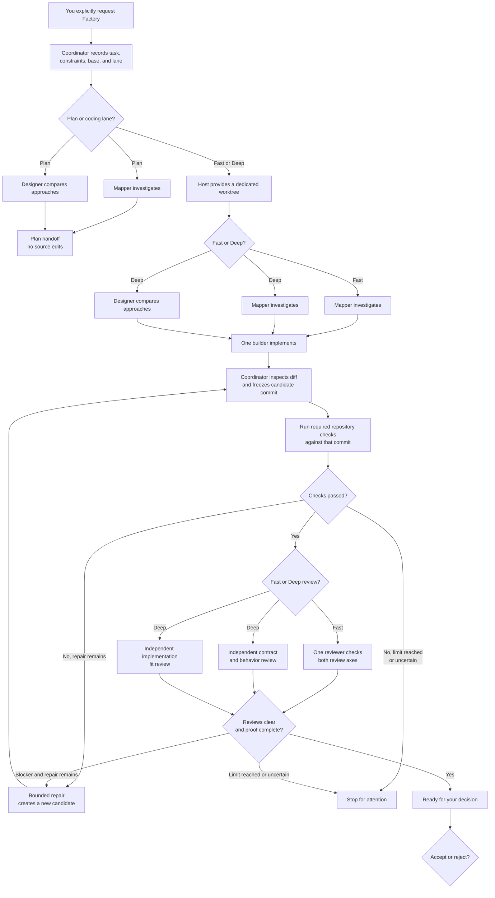

<p align="center">
  
</p>

<h1 align="center">Patchy McPatchface</h1>

<p align="center"><em>Find the code that owns the behavior before adding more.</em></p>

<p align="center">
  <a href="https://github.com/Shivansh-Gaur2/patchy-mcpatchface/actions/workflows/validate.yml"></a>
  
  
</p>

Patchy is a collection of coding-agent skills for repository work. It helps an agent recover the requested behavior, find the code that owns it, reuse that code where it fits, make a focused change, and explain what the available evidence does and does not establish.

Use it when you want an agent to work with a codebase's existing rules and patterns instead of jumping straight from a task description to new code.

## Get started with Codex

Add the marketplace and install the plugin:

```sh
codex plugin marketplace add Shivansh-Gaur2/patchy-mcpatchface --ref master
codex plugin add patchy-mcpatchface@patchy-mcpatchface
```

Start a new Codex task, then mention the skill you want. For example:

```text
@patchy Add an endpoint to cancel a pending order. Find the existing order rules and tests first.
```

Or ask a question without requesting edits:

```text
@patchy-rummage Trace how a checkout becomes paid. Explain the important branches and tests; do not edit files.
```

For a flow that's easier to see than read, ask for a small diagram too:

```text
@patchy-rummage Trace how a checkout becomes paid. Explain the important branches and tests, and include a simple diagram if it helps.
```

If you update the repository and an installed plugin still looks stale, refresh the marketplace entry and reinstall:

```sh
codex plugin marketplace remove patchy-mcpatchface
codex plugin marketplace add Shivansh-Gaur2/patchy-mcpatchface --ref master
codex plugin add patchy-mcpatchface@patchy-mcpatchface
```

## Pick the right skill

| Skill | Use it when you want to… |
| --- | --- |
| `patchy` | Implement a feature, fix a bug, or refactor code where behavior, scope, reuse, or proof matters. |
| `patchy-rummage` | Understand a code path or business rule without changing files. |
| `patchy-review` | Review an existing diff against its request, repository design, and available evidence. |
| `patchy-clipboard` | Use the older name for `patchy-review`; it remains as a compatibility entry point. |
| `patchy-factory` | Coordinate an explicitly requested multi-stage job with specialist roles, checks, review, and a saved handoff. |
| `patchy-help` | See a short reminder of the available entry points. |

### What Patchy does during a coding task

For a meaningful change, Patchy guides the agent through a practical loop:

1. **Capture the request.** Identify the behavior you want, constraints, protected files, and what must remain true.
2. **Find the owner.** Read the repository guidance and trace the relevant code, callers, and nearby tests. Search for reusable services, policies, helpers, and fixtures.
3. **Choose a focused change.** Reuse or extend the current owner when its contract fits. Add a new abstraction only when it has a distinct responsibility.
4. **Check the behavior.** Turn the affected rules into scenarios and run the closest useful checks.
5. **Report the evidence.** Summarize what changed, what ran, and what remains unverified.

For example, if you ask for partial refunds, Patchy should look for the current refund handler and authorization rules before proposing a second refund service. It should also identify the limits and failure cases that a test needs to cover. See the [worked refund example](examples/refund-boundary.md) and [checkout walkthrough](examples/map-a-checkout-flow.md).

The amount of investigation should fit the task. A tiny local edit can use the nearest implementation and its closest check; a change involving shared business rules deserves a wider trace.

### What is installed today

Patchy supplies the engineering instructions. The coding-agent host supplies the model, repository tools, and execution environment. The skills guide the agent in using those tools; they do not run a separate service or create sandbox boundaries themselves.



Factory is still a set of instructions used by the host. This repository does not include a standalone scheduler, agent-provider service, dashboard, or sandbox runtime.

## What Factory does

`patchy-factory` is an optional workflow for jobs where staged work or separate review can justify the added setup. You must explicitly ask for it. It defines three lanes:

| Lane | Stages | Active specialist agents |
| --- | --- | ---: |
| Fast | Mapper → builder → reviewer | At most 1 |
| Deep | Mapper and designer → builder → separate contract and implementation reviews | At most 2 |
| Plan | Mapper and designer; no code changes | At most 2 |

The builder is the only role that edits the candidate. Reviewers assess the frozen candidate against the request and repository fit. The Factory workflow instructs its coordinator to record the base and candidate, run the agreed checks, limit repair rounds, and leave a handoff for your decision. The host must actually provide the agents, worktrees, and tools those steps need.

Here is the workflow the Factory instructions describe. Plan stops before implementation; coding lanes freeze a candidate before its checks and reviews.



Each repaired candidate needs fresh checks and reviews because the previous evidence applies only to the earlier commit. The workflow describes at most two repair rounds. An accepted handoff records your decision; it does not merge, push, release, or deploy.

Factory is a **skill-guided coordination process**, not a standalone orchestration service. It relies on the coding-agent host for subagents and worktrees. When separate agents are unavailable, supported stages can run in sequence and the review must be labeled self-review, not independent review. A high-risk task that requires independent review stops if the host cannot provide it. Optional Codex agent profile templates are under [`agents/factory/`](agents/factory/); installing the plugin does not register those profiles.

Factory does not merge, push, release, or deploy. Its worktree helps isolate routine edits from the active checkout, but it is not an operating-system security sandbox. See the [Factory workflow](skills/patchy-factory/SKILL.md) for the full process and limitations.

## Install another way

### Portable skill bundle

Clone the repository into your Codex skills directory, then start a new chat:

```powershell
git clone https://github.com/Shivansh-Gaur2/patchy-mcpatchface.git "$env:USERPROFILE\.codex\skills\patchy-mcpatchface"
```

The root [`SKILL.md`](SKILL.md) points to the canonical workflow in [`skills/patchy/SKILL.md`](skills/patchy/SKILL.md). `AGENTS.md` and [Copilot instructions](.github/copilot-instructions.md) provide instruction-only fallbacks for hosts that read those files; they do not add plugin commands or lifecycle hooks.

### `skills.sh`

This repository can also be installed with [`skills.sh`](https://github.com/isiahhill/skills.sh):

```sh
npx skills add Shivansh-Gaur2/patchy-mcpatchface --skill patchy-mcpatchface --agent codex
```

Replace `codex` with an agent supported by `skills.sh`, then start a new agent session.

## How the repository is organized

The root files are the source of truth. The plugin package under `plugins/patchy-mcpatchface/` is generated from them.

| Path | What it contains |
| --- | --- |
| [`skills/patchy/SKILL.md`](skills/patchy/SKILL.md) | The core workflow for implementation tasks. |
| [`skills/patchy-rummage/`](skills/patchy-rummage/SKILL.md), [`skills/patchy-review/`](skills/patchy-review/SKILL.md) | Read-only code-path mapping and diff review. |
| [`skills/patchy-factory/`](skills/patchy-factory/SKILL.md) and related Factory skills | Coordinator and specialist role instructions. |
| [`references/`](references/) | Supporting guidance, including evidence tiers and compact TOON receipts. |
| [`rules/patchy-fallback.md`](rules/patchy-fallback.md) | Canonical fallback instructions copied to `AGENTS.md` and Copilot instructions. |
| [`scripts/build-marketplace.mjs`](scripts/build-marketplace.mjs) | Generates the marketplace plugin copy from the root source files. |
| [`plugins/patchy-mcpatchface/`](plugins/patchy-mcpatchface/) | Generated package consumed by the Codex marketplace. |

TOON is an optional compact format for repeated, uniform evidence rows such as callers or check results. Explanations remain ordinary prose, and source code, configuration, API payloads, and irregular data keep their native formats. A token comparison for one fixture is not evidence that every task or model uses fewer tokens.

## Current evidence and limitations

The repository's `npm test` checks package structure, local Markdown links, TOON examples and a token fixture, fallback copies, and alignment of the generated marketplace package. These checks show that repository artifacts are coherent; they do not measure coding outcomes.

There are no published comparative results showing that Patchy or Factory improves coding speed, correctness, or quality. The [benchmark plan](benchmarks/README.md) and [results ledger](benchmarks/RESULTS.md) describe the matched runs and evidence required before making those claims.

Also keep in mind:

- Patchy is guidance for a coding agent. The host determines which tools, skills, subagents, profiles, and worktree features are available.
- The Factory run record and stage rules are specifications for the coordinating agent; this repository does not provide durable job execution or automatic crash recovery.
- A skill cannot know unstated business rules. It can make constraints and unknowns visible, then use repository evidence to check the rules it can find.
- A passing check only supports the behavior it exercises. The agent should name important behavior it could not verify.
- Factory adds coordination overhead. Use ordinary `patchy` for short or straightforward work.
- Factory's isolated worktree is not a security boundary, and its profile templates do not install themselves.

## Contribute

Try Patchy on a real task and report what happened: what it found, what it missed, whether the change stayed in scope, and which checks actually ran. Concrete failures and neutral results help improve it.

Before opening a pull request:

1. Keep `skills/patchy/SKILL.md` as the source of truth for the core workflow.
2. Update root sources first; regenerate the marketplace copy with `npm run build:marketplace` when packaged files change.
3. Run `npm test` and include the relevant output in your pull request.
4. Add a benchmark case when a workflow change materially changes behavior, and avoid performance or safety claims without reproducible evidence.

Read [`CONTRIBUTING.md`](CONTRIBUTING.md) for contribution principles, [`CHANGELOG.md`](CHANGELOG.md) for release history, and the [maintainer checklist](docs/maintainer-checklist.md) for GitHub settings and release controls.

## License

[MIT](LICENSE).
