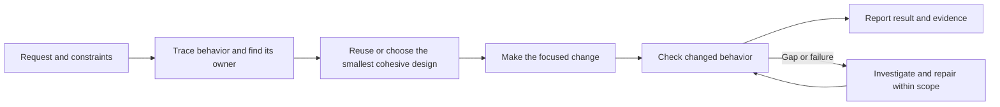
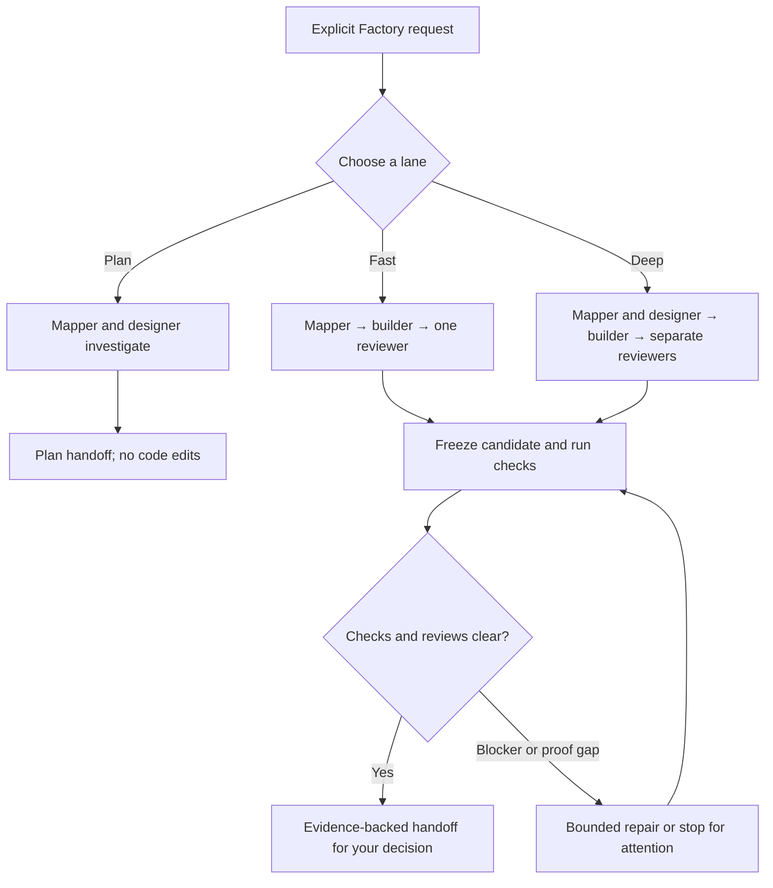

# Patchy

Patchy helps coding agents make changes that fit the codebase and come with evidence. It starts from the requested behavior, finds the code that owns it, reuses that owner where it fits, then checks what the change actually proves.

Use `patchy` for implementation work with meaningful behavior, design, or verification risk. For a tiny, obvious edit, inspect the target, make the smallest change, and run its nearest check. Don't turn routine work into a ceremony.

## The Patchy workflow

### 1. Capture the contract

Identify the observable goal, constraints, protected boundaries, invariants, and acceptance evidence. Surface unknowns that could change the design. Ask a focused question only when the missing answer affects the solution; otherwise record a small, reversible assumption.

### 2. Trace before editing

Read the repository's instructions, the relevant entry point, its callers, and nearby tests. Follow the behavior through decisions, state changes, persistence, external calls, and errors as far as the task requires. Label claims **Observed**, **Inferred**, or **Unknown** so guesses do not become repository facts.

### 3. Reuse and choose a design

Search for existing services, policies, types, helpers, adapters, fixtures, and error conventions. Reuse the current owner when its contract fits; extend it when the new case belongs there. Create a new boundary only when it has a distinct responsibility. For a material design choice, compare one credible alternative and choose the smallest cohesive option that keeps each decision with its owner.

### 4. Make the focused change

Change only the behavior and boundaries needed for the request. Preserve authorization, data integrity, compatibility, and error handling where the traced path depends on them. Keep optional improvements as follow-ups instead of silently broadening the patch.

### 5. Verify and leave a receipt

Turn affected invariants and branches into checks. Run focused behavior tests first, followed by relevant build, type, lint, or integration checks. A green unrelated test is not proof. State what changed, what checks ran, what remains unverified, and any material residual risk.

## Choose the right entry point

| Entry point | Use it for |
| --- | --- |
| `patchy` | Implementing a feature, bug fix, or refactor where behavior, scope, reuse, or proof matters. |
| `patchy-rummage` | Explaining a behavior path without changing files. |
| `patchy-review` | Independently reviewing an existing diff against its request and repository fit. |
| `patchy-factory` | Coordinating a staged job when separate roles, checks, and reviews justify the overhead. |
| `patchy-help` | Finding a concise reminder of the available entry points. |
| `patchy-clipboard` | Compatibility alias for `patchy-review`. |

## Patchy Factory

Factory is an opt-in coordination workflow for larger or riskier tasks. It assigns bounded responsibilities: the mapper investigates, the designer compares approaches, the builder edits, and reviewer roles inspect a frozen candidate. The host must provide the agents, worktrees, and tools the requested lane needs.

Factory does not merge, push, release, or deploy. Separate reviews are independent only when the host actually runs separate reviewers; otherwise the result must be labeled self-review. Its worktree is an isolation aid, not an operating-system security boundary. See the [Factory instructions](skills/patchy-factory/SKILL.md) for lane rules and limits.

## What Patchy provides

Patchy provides instructions and reusable workflows for the coding-agent host. The host supplies the model, repository access, execution environment, and optional agent or worktree features. Patchy does not run a separate orchestration service, guarantee correctness, or claim productivity gains without matched evidence.

The repository's [core workflow](skills/patchy/SKILL.md) has the full investigation, reuse, and verification guidance. Install this root skill as **`patchy`** from [the repository](https://github.com/Shivansh-Gaur2/patchy-mcpatchface); the repository keeps its longer name, while the skill's invocation stays short.
